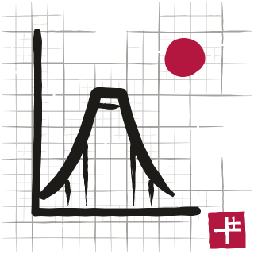

<div align="center">

<picture>
  <source media="(prefers-color-scheme: dark)"  srcset="docs/public/logo-dark.svg">
  <source media="(prefers-color-scheme: light)" srcset="docs/public/logo.svg">
  
</picture>

#### *gnuplot-like plots from pure Fortran: interactive HTML, SVG and text*

### **FOR**tran **E**asy **S**vg **I**nteractive **G**nuplot-like **H**tml **T**ool

> A library and a command line tool that draw what gnuplot draws, from your solver or from a gnuplot script: one
> self-contained page per plot, zoomable in the browser, re-rendered live while the run writes its logs. No dependency
> beyond a Fortran compiler.

[](https://github.com/szaghi/foresight/releases)
[](https://github.com/szaghi/foresight/actions/workflows/ci.yml)
[](https://github.com/szaghi/foresight/actions/workflows/matrix.yml)
[](https://github.com/szaghi/foresight/actions/workflows/ci.yml)
[](https://fortran-lang.org/)
[](LICENSE.gpl3.md)
[](LICENSE.bsd-2.md)
[](LICENSE.bsd-3.md)
[](LICENSE.mit.md)

<div>
<table>
<tr>
<td><b>🖱️ Interactive pages, from Fortran</b><br><sub>One self-contained HTML page per plot: wheel and box zoom, pan, gnuplot's hotkeys, series hidden from the key, dashboard panels zoomed together, live coordinates; the same figure as SVG, or as text in the terminal (<code>dumb</code>, <code>block</code>, Braille, ANSI colors). <a href="https://szaghi.github.io/foresight/guide/viewer">Interactive viewer</a> · <a href="https://szaghi.github.io/foresight/guide/output-formats">Output formats</a></sub></td>
<td><b>📈 gnuplot's semantics, checked against gnuplot</b><br><sub>A gnuplot 6.0 subset, each feature probed on gnuplot before it is written: autoscale to the tick grid, log and reversed axes, two x and two y axes, tick lists and minor ticks, blocks, datasets and CSV, user variables and functions, strings and <code>sprintf</code>, text columns (<code>strcol</code>), time axes (<code>set xdata time</code>), datablocks, arrays, <code>load</code>/<code>call</code>/<code>eval</code>, <code>system</code>, <code>reset</code>, <code>pause</code> loops, <code>set table</code>, <code>do for</code>, <code>plot for</code>, <code>stats</code> and <code>fit</code> (gnuplot's algorithms, its digits; from Fortran too), <code>set label</code>, <code>set arrow</code>, <code>set object</code> and their styles, gnuplot's linetype colors and dash types. <a href="https://szaghi.github.io/foresight/guide/gnuplot-subset">gnuplot subset</a> · <a href="https://szaghi.github.io/foresight/guide/features">Feature map</a></sub></td>
</tr>
<tr>
<td><b>📊 Every 2-D style</b><br><sub>Lines, steps, impulses, error bars; boxes, histograms (clustered, error bars, row and column stacks, groups), box plots, candlesticks; filled curves and patterns; vectors, ellipses, polygons, labels; <code>smooth</code> splines (monotone too), Bézier, kernel density, <code>bins</code>; colors per point (<code>lc variable</code>, <code>lc palette</code>); polar plots, wind roses, parallel axes and spider plots; heatmaps with gnuplot's palettes and named perceptual ones. <a href="https://szaghi.github.io/foresight/manual/cookbook">Cookbook</a></sub></td>
<td><b>🗻 3D views, as gnuplot draws them</b><br><sub><code>splot</code> of functions, grids and scattered data: meshes with <code>set hidden3d</code>, <code>set view</code> and the map view, contours on the base or the surface, pm3d surfaces depth sorted and lit (<code>set pm3d lighting</code>), filled contours (<code>with contourfill</code>), error bands (<code>zerrorfill</code>), 3D bars (<code>set boxdepth</code>), polygons and grid walls, the side projections (<code>set view projection xz|yz</code>), gnuplot's binary files; each checked polygon by polygon against gnuplot 6.0, and each drawn from Fortran too. <a href="https://szaghi.github.io/foresight/guide/gnuplot/3d#_3d-views">3D views</a> · <a href="https://szaghi.github.io/foresight/manual/cookbook#a-colored-surface-in-3d">Cookbook</a></sub></td>
</tr>
<tr>
<td><b>🛰️ Live monitoring</b><br><sub><code>foresight --watch</code> re-renders while a job appends to its logs: the page reloads keeping your zoom, or following the newest data; in the terminal the text plot is redrawn in place, over plain ssh. <a href="https://szaghi.github.io/foresight/guide/monitoring">Live monitoring</a> · <a href="https://szaghi.github.io/foresight/manual/paths/b-monitoring/02-watching-the-run">Tutorial</a></sub></td>
<td><b>🎌 Themes, light and dark</b><br><sub><code>washi</code> and <code>night</code>, ink on warm paper and light on a near-black ground, the colors of the documentation (its figures follow its light and dark modes); <code>vfd</code> and <code>lcd</code>, the dashboards of 1980s cars, with seven-segment readouts, gauges and segmented bars. <code>foresight --theme</code> or <code>FORESIGHT_THEME</code> picks the default. <a href="https://szaghi.github.io/foresight/guide/gnuplot/styles#themes-and-segmented-fills">Themes</a></sub></td>
</tr>
<tr>
<td colspan="2"><b>🧰 Pure Fortran, three compilers</b><br><sub>Fortran 2018 plus libc <code>rename</code>, <code>nanosleep</code> and <code>popen</code>: no Python, no gnuplot, no graphics library. gfortran, nvfortran and ifx, debug and optimised, on every push; 15 test programs, 154 byte-exact golden files, tick labels built from integers (<code>0.3</code>, never <code>0.30000000000000004</code>); built with FoBiS or fpm. <a href="https://szaghi.github.io/foresight/guide/install">Installation</a> · <a href="https://szaghi.github.io/foresight/guide/contributing">Contributing</a></sub></td>
</tr>
</table>
</div>

**[Full documentation](https://szaghi.github.io/foresight/)**: [start](https://szaghi.github.io/foresight/guide/) · [tutorial](https://szaghi.github.io/foresight/manual/paths/a-first-steps/01-a-first-plot) · [cookbook](https://szaghi.github.io/foresight/manual/cookbook) · [reference](https://szaghi.github.io/foresight/guide/features) · [gnuplot subset](https://szaghi.github.io/foresight/guide/gnuplot-subset) · [API](https://szaghi.github.io/foresight/guide/api-reference)

<picture>
  <source media="(prefers-color-scheme: dark)"  srcset="docs/public/examples/cb_multiplot-dark.svg">
  <source media="(prefers-color-scheme: light)" srcset="docs/public/examples/cb_multiplot.svg">
  
</picture>

</div>

---

## Quick start

```bash
git clone https://github.com/szaghi/foresight && cd foresight
fobis fetch                                                   # PENF, BeFoR64, FACE, StringiFor, into src/third_party/
fobis build --mode foresight-gnu                              # the command line tool: bin/foresight
fobis build --mode foresight-static-gnu                       # the library: lib/libforesight.a, modules in lib/mod
fobis build --mode tests-gnu && bash scripts/run_tests.sh     # the 11 test programs, golden files included
```

or the one-line installer, the latest release into `~/.local`, usable through pkg-config:

```bash
curl -fsSL https://github.com/szaghi/foresight/releases/latest/download/install.sh | bash
```

as a FoBiS dependency, in the `fobos` of your project (then `fobis fetch && fobis build`):

```ini
[dependencies]
deps_dir   = src/third_party
PENF       = https://github.com/szaghi/PENF :: branch=master       # foresight's own dependencies: fobis fetch
BeFoR64    = https://github.com/szaghi/BeFoR64 :: branch=master    # is not transitive
FACE       = https://github.com/szaghi/FACE :: branch=master
StringiFor = https://github.com/szaghi/StringiFor :: branch=master
foresight  = https://github.com/szaghi/foresight :: branch=master
```

or as an fpm dependency, in your `fpm.toml`:

```toml
[dependencies]
foresight = { git = "https://github.com/szaghi/foresight", branch = "master" }
```

A plot from Fortran:

```fortran
use foresight, only : figure_object, I4P, R8P
type(figure_object)    :: fig
real(R8P), allocatable :: t(:)
integer(I4P)           :: i

t = [(0.1_R8P * i, i = 0, 100)]
call fig%set_title('Damped oscillation')
call fig%plot(t, exp(-0.3_R8P * t) * cos(2.0_R8P * t), title='u(t)')
call fig%plot(t, exp(-0.3_R8P * t), title='envelope', dt=2_I4P)
call fig%save('quickstart.html')   ! interactive page; .svg static, .txt text
```

or from the shell, with a gnuplot script:

```bash
foresight residuals.gp                                  # residuals.html
foresight --watch residuals.gp                          # re-rendered while residuals.dat grows
foresight --watch -e "set terminal dumb" residuals.gp   # the same, as text in the terminal
foresight -t night -o residuals.svg residuals.gp        # an SVG in the dark theme
```

The [tutorial](https://szaghi.github.io/foresight/manual/paths/a-first-steps/01-a-first-plot) goes from a first plot to a live
dashboard of a running solver; the [gnuplot subset](https://szaghi.github.io/foresight/guide/gnuplot-subset) lists every
command, option and style, and where foresight departs from gnuplot.

## Authors

**[Stefano Zaghi](https://github.com/szaghi)** · stefano.zaghi@gmail.com
> *Chief Yak Shaver & Serial Library Resurrector* — trusts no plotting tool he has not rewritten, and has now rewritten
> one

**[Claude](https://claude.ai)** (Anthropic)
> *Omniscient Code Oracle & Tireless Rubber Duck* — AI pair programmer, responsible for probing gnuplot 6.0 before every
> feature and for running the golden tests all night so humans don't have to

Contributions are welcome: see the [Contributing](https://szaghi.github.io/foresight/guide/contributing) page.

## License

foresight is available under your choice of license:

| License | SPDX | File |
|---|---|---|
| GNU General Public License v3 | `GPL-3.0-or-later` | [LICENSE.gpl3.md](LICENSE.gpl3.md) |
| BSD 2-Clause | `BSD-2-Clause` | [LICENSE.bsd-2.md](LICENSE.bsd-2.md) |
| BSD 3-Clause | `BSD-3-Clause` | [LICENSE.bsd-3.md](LICENSE.bsd-3.md) |
| MIT | `MIT` | [LICENSE.mit.md](LICENSE.mit.md) |

The named palettes carry third-party color tables: the *Scientific colour maps* by Fabio Crameri (MIT,
[doi:10.5281/zenodo.1243862](https://doi.org/10.5281/zenodo.1243862)), matplotlib's magma, inferno, plasma and
viridis (CC0), cividis by Nuñez, Anderton and Renslow (matplotlib's licence, Battelle Memorial Institute's licence),
and Kenneth Moreland's black_body (CC0); their notices are in `src/lib/foresight_colormaps.F90`.

The compiled-in fonts keep their own licenses, not foresight's: Liberation Sans (SIL Open Font License 1.1) and Latin
Modern Roman and Math (GUST Font License); see [LICENSES/README.md](LICENSES/README.md).

© [Stefano Zaghi](https://github.com/szaghi)
