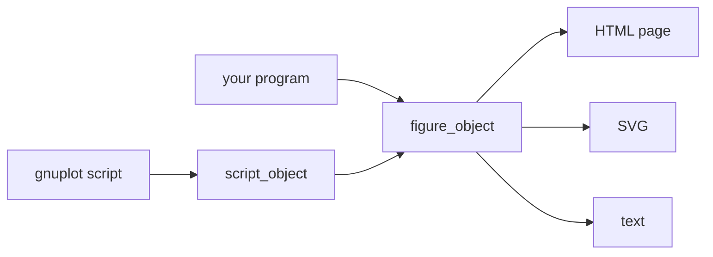

# Feature map

Everything foresight does, and where it is documented. The [tutorial](/manual/) shows it at work; the
[cookbook](/manual/cookbook) one task at a time.

| Area | Features | Where |
|---|---|---|
| Plot styles | `lines`, `points`, `linespoints`, `impulses`, `steps`, `fsteps`, `histeps`, `dots`, `yerrorbars`, `xerrorbars`, `xyerrorbars`, `yerrorlines`, `xerrorlines`, `xyerrorlines`, `boxerrorbars`, `boxxyerror`, `candlesticks`, `financebars`, `boxplot` (quartiles, factors, outliers), `vectors`, `arrows`, `ellipses`, `polygons`, `labels`, `sectors`, `parallelaxes`, `spiderplot` (`set paxis`), `boxes`, `filledcurves` (bars from 0, bands, `x1`, `x2`, `y1`, `y2`, `x=V`, `xy=`, `above`/`below`; fill styles and patterns, `set boxwidth`), `histograms` clustered, with error bars, row- and column-stacked, in groups (`newhistogram`), with `xtic(N)` category labels; gnuplot linetype colors (`set colorsequence default\|podo\|classic`, and foresight's categorical orders), colors per point (`lc variable`, `lc rgb variable`) and from the palette (`lc palette z\|cb V\|frac F`), dash types, widths, 15 point types and sizes, `pointinterval`; `set style line`, `ls`; `set errorbars` caps and lines | [gnuplot Subset](gnuplot-subset#styles), [colors per point](gnuplot-subset#colors-per-point-and-from-the-palette), [point types](gnuplot-subset#point-types) |
| Axes | linear and log scales, fixed or autoscaled ends extended to the ticks, reversed ranges; tick steps, `mirror`, printf label formats and gnuplot's powers and prefixes (`10^{%T}`, `%s %c`), tick label offset and color, ticks on the axes (`axis`), range frames (`rangelimited`); a second y axis, a second x axis; time axes (`set xdata time`, `set timefmt`, gnuplot's time ticks and invented labels, `set mxtics time N units`); text labels from the data on any axis (`xtic`, `x2tic`, `ytic`, `y2tic`); `set tics` options and scale, `set grid` lines and style, zero axes, border style, margins, `set autoscale` | [Ticks](gnuplot-subset#ticks-and-label-formats), [Second y axis](gnuplot-subset#second-y-axis), [Second x axis](gnuplot-subset#second-x-axis), [Time data](gnuplot-subset#time-data) |
| Annotations | `set label`, `set arrow`, `set object` rectangles, circles, ellipses, polygons, in first, second, graph, screen or character coordinates, front or back; arrow styles (`set style arrow`, `as N`), `set style rectangle`, dashed borders | [Labels, arrows and objects](gnuplot-subset#labels-arrows-and-objects) |
| Text | gnuplot's enhanced text, on by default in scripts: `x^2`, `T_{n-1}`, `{/Symbol a}`, `{/=16 ...}`, `{/:Bold ...}`, `@`, `&`, `~`, escapes; `noenhanced` per text; the viewer's zoomed tick labels too | [Enhanced text](gnuplot-subset#enhanced-text) |
| Key | inside (any corner, centred), `outside`, `below`/`above` in rows, the margins (`lmargin`, `rmargin`, `tmargin`, `bmargin`), `at` a position (data, graph or page coordinates), box, opaque; `reverse`, `Left`, `invert`, `samplen`, `spacing`, `width`, `height`, `maxrows`, `maxcols`, `textcolor`, box line style, `offset`, a title; titles as written, from column headers, or none | [Key](gnuplot-subset#key) |
| Data files | whitespace, CSV or any separator; comments, blocks, datasets; `using`, `index`, `every`; column 0; missing values; cells read as gnuplot (C `strtod`) | [Data Files](data-files) |
| Expressions | `using ($2*1e3)`, `column("name")`, `?:`, `1/0` gaps, gnuplot's integer arithmetic and functions, its special functions (`erf`, `gamma`, `igamma`, `besj0`, `lambertw`, ... to its last digit), bitwise operators, hex and octal integers; user variables and functions (`a = 2`, `f(x) = a*sin(x)`), recursive ones too, expressions in range ends | [Expressions](gnuplot-subset#expressions-in-using) |
| Column headers | `using 1:"residual"`, `title columnhead`, `set key autotitle columnhead` | [Column headers](gnuplot-subset#column-headers) |
| Functions | `plot sin(x)/x`, sampled over the data x range, `set samples`, `set style function` | [Functions](gnuplot-subset#functions) |
| Smoothing | `smooth unique`, `frequency`, `fnormal`, `cumulative`, `cnormal`: averages of repeated x, histograms, distributions; curves `csplines`, `acsplines`, `bezier`, `sbezier`, `mcsplines`, `kdensity [bandwidth B]`; `bins[=N]` with `binrange`, `binwidth`, `binvalue` | [Smoothing](gnuplot-subset#smoothing), [Bins](gnuplot-subset#bins) |
| Strings | literals, `.`, `eq`/`ne`, `s[i:j]`, `sprintf` (C's, from the exact binary value), `strlen`, `substr`, `strstrt`, `words`, `word`, `trim`, `gprintf`; string variables and functions; string expressions wherever a string goes (titles, labels, file names, output); the text of data columns (`strcol`, `columnhead`), labels and tick labels built from it; `strftime`, `strptime`, `timecolumn` | [Strings](gnuplot-subset#strings), [String columns](gnuplot-subset#string-columns) |
| Scripts | datablocks (`$DATA << EOD`, `$DATA[i]`, `\|$DATA\|`), `load`, `call` with `ARG1`..`ARG9` and `ARGV`, `eval`, `@` macros, `undefine`; function blocks (`function $f << EOF`, `local`, `return`); `foresight -c SCRIPT ARGS` | [Datablocks and scripts](gnuplot-subset#datablocks-and-scripts) |
| Arrays | `array A[N]`, `array A = [...]`, `A[i]`, slices `A[i:j]`, `\|A\|`, `index(A, v)`; `print A`, `plot A`, `stats A`; gnuplot's undefined value | [Arrays](gnuplot-subset#arrays) |
| Runtime | `system("cmd")`, `` `cmd` ``, `system "cmd"`; `reset [session]`; `pause` and the live loop `while (1) { plot ...; pause N }` | [Shell commands, reset and pause](gnuplot-subset#shell-commands-reset-and-pause) |
| Tables | `set table "file"\|$NAME [append] [separator S]`: the points of a plot as gnuplot's text table, to a file, a datablock or the terminal; `plot ... with table [if COND]`, the rows as text | [Tables](gnuplot-subset#tables) |
| Print | `print` values, `set print "file"\|$NAME [append]` | [Print](gnuplot-subset#print) |
| Blocks | `do for [i=a:b]`, `do for [w in "..."]`, `while`, `if/else`, `break`, `continue`, blocks over lines | [Blocks and loops](gnuplot-subset#blocks-and-loops) |
| Iteration | `plot for [i=a:b] ...`, `set for [...]`, nested clauses, `using 1:i`, `lc i` | [Iteration](gnuplot-subset#iteration) |
| Statistics | `stats [x] [y] 'file' using N[:M] [name "P"] [output]`: gnuplot's STATS_* variables and report, silent unless asked; `stats(y)`, `stats(x, y)` from Fortran | [Stats](gnuplot-subset#stats), [Library](library#statistics) |
| Fitting | `fit [min:max] f(x) 'file' using X:Y[:ERR] via a, b`, gnuplot's Marquardt-Levenberg to its digits; `a_err`, `FIT_*` variables; silent unless `set fit results` / `logfile`; `fit(model, x, y, params)` from Fortran | [Fit](gnuplot-subset#fit), [Library](library#fitting-a-model) |
| Layout | multiplot grids with a title, panels in `origin`/`size` boxes (insets) | [Multiplot](gnuplot-subset#multiplot) |
| Output | interactive HTML (one self-contained page), SVG, text with characters (`dumb`) or Unicode blocks and Braille (`block`), in ANSI colors; atomic rewrites | [Output Formats](output-formats) |
| Viewer | wheel and box zoom, pan, `u` `a` `g` `h`, live coordinates (y2 and x2 too), ticks and markers regenerated on zoom; series hidden from the key; panels sharing x zoomed together; following the end of a live run; the view kept in the URL | [Interactive Viewer](viewer) |
| Circles and pies | `with circles` (bubbles, wedges); foresight's `with pie [donut F]`, slices named by `xtic(N)` with their percentages | [Circles, pies](gnuplot-subset#circles-pies-and-donuts) |
| Panel charts | foresight extensions: `with gauge` (sweep gauges of the last value, segmented), `with radar`, `with rose` (area by value) | [Gauges, radars, roses](gnuplot-subset#gauges-radars-and-roses) |
| Polar plots | `set polar`, `set angles`, `set theta`, `rrange`, `trange`, `set grid polar`, `set border polar`, `rtics`, `ttics`, `set size square`; functions of `t` | [Polar plots](gnuplot-subset#polar-plots) |
| Images | `with image` heatmaps and `rgbimage`/`rgbalpha` colors of `x:y:z` grids or `matrix` files; palettes (`rgbformulae`, `defined`, `cubehelix`, `file`, `gray`, `viridis`, `negative`, `maxcolors`; foresight extension: named perceptual palettes, Crameri's Scientific colour maps, matplotlib's and Moreland's black body), `cbrange`, `cblabel`, `cbtics`, `set format cb`, `set logscale cb`, color box (vertical or horizontal, default or user placed, `invert`, `noborder`); embedded PNG, sharp at any zoom | [Images](gnuplot-subset#images-and-palettes) |
| Themes | foresight extension: `set terminal ... theme vfd\|lcd\|washi\|night\|classic [glow\|noglow]` (`foresight --theme` sets the default), 1980s dashboard colors and glow, the site's light and dark identity; segmented bars (`fs solid segments N`) with unlit cells | [Themes](gnuplot-subset#themes-and-segmented-fills) |
| Readouts | foresight extension: `with readout`, the last value of an item in seven-segment digits on a glass fixed by `format`; blocks of readouts over the curves or filling a panel; `set readout` | [Readouts](gnuplot-subset#readouts) |
| Monitoring | `--watch`: re-render on any change of the script or its data; reloading pages that keep the zoom or follow the newest data; the text terminal redrawn in place | [Live Monitoring](monitoring) |
| Library | `figure_object` (methods mirroring gnuplot commands), `script_object` (the interpreter) | [Fortran Library](library), [API](/api/) |
| Command line | `foresight [-e CMDS] [-o OUT] [-t THEME] [-w [S]] [--max-cycles N] [SCRIPT \| -c SCRIPT ARGS]` | [Command Line](cli) |
| Engineering | pure Fortran 2018; exact tick labels from integers; byte-exact golden tests; never an IEEE exception on bad data | [Architecture](architecture) |

