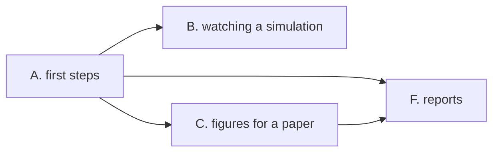

# Learning paths

foresight serves readers who arrive with different jobs: a first plot from a Fortran program, a long run to watch, a
figure for a paper, fields and surfaces, a gnuplot script that should keep working, a report to write. Each path is a
short series of chapters for one of them. A chapter states its goal, shows the program or the script, the plot it
writes, why it works, what to try next and the pitfalls; every program is in
[`docs/examples/src`](https://github.com/szaghi/foresight/tree/master/docs/examples/src), and every plot on these pages
is the one it wrote, regenerated by the CI.

| Path | For | Chapters |
|---|---|---|
| [A. First steps](./paths/a-first-steps/01-a-first-plot) | a first plot from Fortran, then from a script | a first plot, styles and the key, axes, scripts, CSV and expressions, two axes |
| [B. Watching a simulation](./paths/b-monitoring/01-a-dashboard) | a job that runs for hours | a dashboard, watching the run |
| [C. Figures for a paper](./paths/c-paper/01-a-first-pdf) | a figure a journal takes as it is | PDF, embedded fonts, sizes, panels, the paper, LaTeX labels, math |
| [F. Reports](./paths/f-reports/01-a-figure-in-a-report) | a Markdown or LaTeX report written by the program | a figure in a report, tables, the report, print and web, LaTeX reports |



Path A is the start for everyone who has not used foresight: its first three chapters use the Fortran library, the
next three the command line, the same engine (a script is what a program writes through `figure_object` calls, line by
line). The others can be read in any order after it.

## Then

The [Cookbook](./cookbook) answers one task per recipe; the [Reference](/guide/features) covers every command and
method, the [gnuplot subset](/guide/gnuplot-subset) by topic.

## Running the examples

```bash
bash scripts/docs_examples.sh
```

builds the library and the command line, compiles and runs every example, and regenerates the snippets, outputs and
plots these pages include. Every plot is drawn twice, in the washi theme for the light mode of these pages and in the
night theme for the dark mode (`FORESIGHT_THEME`): the switch at the top of the page shows the other. The CI runs it
too and fails if any of them differs from the committed one.
