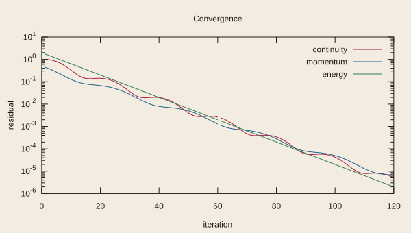
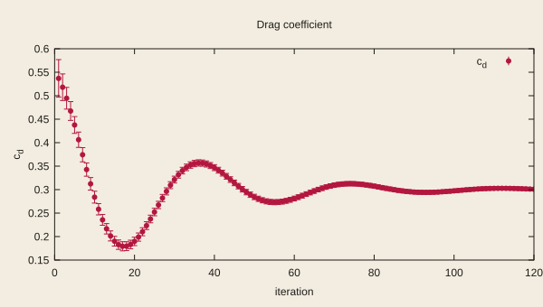
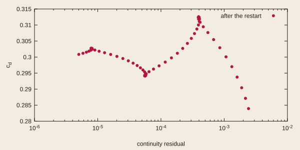

# Run report

The pretend flow solver of path A: 120 iterations, a restart at iteration 60. This page, its figures and its tables were written by `pf_report.f90`.

*Figure 1. The three residuals fall by five decades or more; the restart at iteration 60 does not disturb them.*

*Figure 2. The drag coefficient settles at 0.30; its error bars shrink as one over the square root of the iteration.*

*Figure 3. The drag coefficient against the continuity residual after the restart: it closes in on 0.30 as the residual falls.*

## Statistics

The last 60 iterations, after the restart.

| quantity | mean | standard deviation | min | max |
| --- | --: | --: | --: | --: |
| drag coefficient |  0.30105 |  0.00627 |  0.28394 |  0.31261 |
| log10 continuity residual |   -4.079 |    0.781 |   -5.299 |   -2.615 |

## History

Every 20 iterations, from `run.csv`.

| iteration | continuity | momentum | cd |
| --: | --: | --: | --: |
| 1 | 1.00482 | 0.451026 | 0.536869 |
| 21 | 0.1396 | 0.0649109 | 0.19893 |
| 41 | 0.0187467 | 0.00757335 | 0.341339 |
| 61 | 0.00242609 | 0.00112132 | 0.283936 |
| 81 | 0.000302269 | 0.000238796 | 0.305825 |
| 101 | 3.62696e-05 | 4.53224e-05 | 0.298105 |

